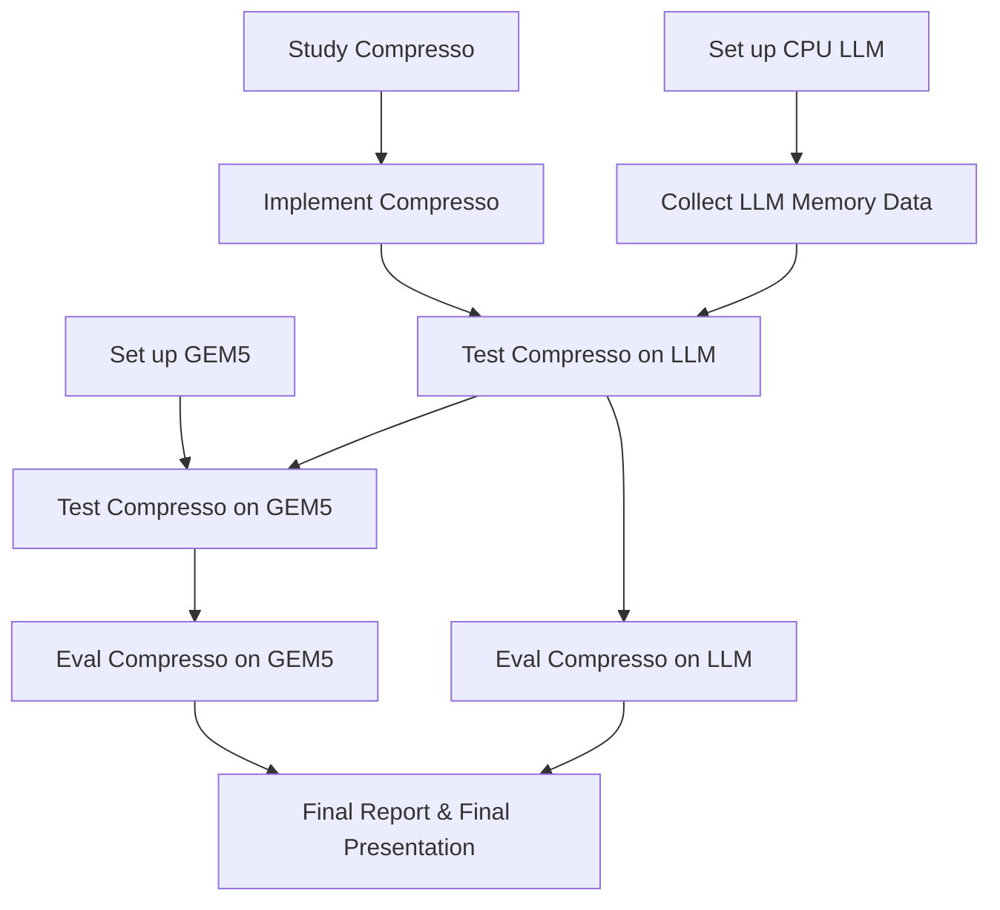

# Compresso Evaluation Project

Evaluate the Compresso compression method on LLM memory data (CPU-based LLM) and on GEM5 simulations.

**Final deadline: December 15th**

## Project Workflow



## Hardware (gem5)

On the laptop's Ubuntu or a CAE Linux machine, from this repo:

```bash
bash sim/setup.sh
bash sim/run-hello.sh
```

`sim/setup.sh` downloads and builds gem5 on that machine. The source is not committed. Details are in `sim/README.md`.
