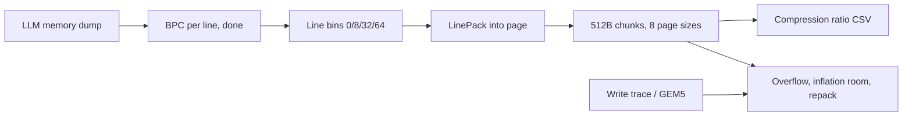

# Compresso implementation tickets

Grill session, 2026-11-19 (plain mode).

## Round 1

**Where we are:** base BPC is done and tested: DBX transform, the Fig. 3b codes, the with/without-transform path, line bins `0/8/32/64 B`, and `BPCConfig` with Compresso defaults.

**What's left from the Compresso paper (MICRO'18):**
- **LinePack**: pack compressed lines inside a page, with offsets kept in metadata
- **Page packing**: 512 B chunks, 8 page sizes from 512 B to 4 KB
- **Metadata**: 64 B per page, plus a metadata cache
- **Overflow handling**: inflation room, dynamic inflation-room expansion, page-overflow predictor, dynamic repacking
- **Alignment-friendly line sizes**: already covered by the bins

There are also project stubs still open: the CLI (Phase 6), validation against the paper (Phase 7), benchmarks (Phase 8) and the BDI baseline. The README also has an LLM data track and a GEM5 track.

Tickets go to **GitHub issues on `thejasha/Compresso_LLM`**. That repo only has the default labels, with no `ready-for-agent` or `model:*` labels.

### Q1 - What does "the compression version" mean?

You said the tickets need to include *the compression version*. Which of these do you mean?

1. **Static capacity model**: take an LLM memory dump, compress every line with BPC, pack lines into pages with LinePack and the 512 B chunk sizes, and report memory saved. This needs only dumps, no timing.
2. **Dynamic model**: also replay writes over time to count overflows, inflation-room use and repacking. This needs a sequence of writes (a trace or GEM5), not just a snapshot.
3. **Both**, as separate tickets.
4. Something else, such as a compressor that writes out an actual compressed file.

**Recommended:** **Both, as separate tickets.** The static model only needs dumps you can already collect and gives the headline compression ratio. The dynamic parts (overflows, inflation room, repacking) need write traces, so they belong with the GEM5 track.

**Answer:** i think typo, i meant the optimized version of the BPC, which they use in compresso and any additional python files needed

### Q2 - Which tickets go to your partner?

You said that for your partner, the tickets should *have the other aspects*. How should the work be split?

1. **Partner takes the Compresso system mechanisms** (LinePack, page packing, metadata, overflow handling). You take parameter choosing plus the CLI and pipeline.
2. **Partner takes the LLM and GEM5 tracks** (collecting data, setting up GEM5). You take all of the Compresso implementation.
3. **No owner per ticket**: whoever is free picks one up.
4. Something else.

**Recommended:** **Partner takes the Compresso mechanisms.** BPC already gives a clean interface (`compress_line` → bits → `binned_bytes`), so they can build the page layer on top without waiting on you, while you work on parameters and the pipeline.

**Answer:** i have one partner working on compresso with me, and 2 more doing LLM and GEM5 each

### Q3 - How should the remaining work be split into tickets?

Options:

1. **By what each part needs** (about 6 tickets):
   - static page model (LinePack, page sizes, metadata size)
   - dynamic overflow model (inflation room, predictor, repacking)
   - parameter choosing
   - CLI and dump pipeline
   - validation against the paper
   - BDI baseline
2. **One ticket per paper mechanism** (about 10 tickets, finer grained).
3. **Coarse** (about 3 tickets): page layer, dynamic layer, parameters.

**Recommended:** **By what each part needs (~6).** Each ticket can then be tested on its own data: dumps for the static parts, traces for the dynamic ones. Each can also be handed to one person without coordinating with the other.

**Answer:** 1, but would like to go over what each ticket needs first and where its in the paper

### Q4 - Which of the open stubs and tracks get tickets now?

Beyond the Compresso mechanisms, the repo also has these open:
- CLI (`cli.py`, Phase 6)
- `validate_vs_paper.py` (Phase 7)
- `bench.py` (Phase 8)
- BDI baseline (`bdi.py`)
- the README's LLM data-collection track and GEM5 track

Pick every one that should get a ticket in this session.

**Recommended:** **CLI + pipeline, validation against the paper, and BDI baseline.** Those are needed to produce and trust any number. Ticket LLM collection and GEM5 too if your partner owns those tracks (see Q2). Bench can wait until speed actually hurts.

**Answer:** accepted the recommendation

### Q5 - What should the parameter-choosing ticket deliver?

`BPCConfig` already makes everything configurable. What should this ticket produce?

1. **A sweep experiment**: run each setting over the LLM dumps and pick the best per data type. Settings to vary: word bits 16 or 32, with or without transform, 4 or 8 bins, 64 or 128 B lines.
2. **Justify the Compresso defaults**: re-derive the paper's choices and document why they hold up for LLM data.
3. **Both**: a sweep, then a written recommendation.

**Recommended:** **Both.** A sweep script that writes a CSV, plus a short write-up for the report that compares against the Compresso defaults. The result to report is the ratio after binning. The raw BPC bit count shouldn't be the headline, since binning is what memory actually saves.

**Answer:** accepted the recommendation

## Round 2

**Round 2: what each ticket needs, and where it is in the paper.** Section numbers refer to `papers/micro18_compresso.pdf` (MICRO'18); the page is in brackets.

**About Q1:** Compresso's BPC changes are only two (§I [p2], §II-A [p2–3]): 64 B granularity, and compressing **with and without** the transform in parallel and keeping the better result. Both are already in `bpc.py`, along with the alignment-friendly line bins `0/8/32/64` (§IV-B1 [p5]). What's left on the BPC side is to check our reading of "without the transform" and to measure the paper's claimed **+13% vs baseline BPC**.

Each card below is a proposed ticket. Accept it, or edit what it should contain.

### Q6 - Where do the dynamic mechanisms (overflow, inflation room, repacking) run?

Overflow handling, inflation room, the page-overflow predictor and repacking (§IV-B2–4 [p5–6]) only matter when lines are **rewritten over time**. There are two ways to model that:

1. **In Python, replaying a write trace.** The GEM5 teammate exports a trace of writebacks (address + new 64 B data), and our model replays it.
2. **Inside GEM5 (C++).** The GEM5 teammate implements it, and we only provide BPC sizes.
3. **Skip the dynamic parts.** Evaluate capacity only, from dumps.

This decides whether the dynamic ticket belongs to the Compresso pair or to GEM5.

**Recommended:** **Python, replaying a GEM5 trace.** The logic stays next to `bpc.py` where you two can test it. GEM5 only needs to dump writebacks, which is a much smaller job than porting Compresso to C++. The report can then cover both capacity (from dumps) and data movement (from the trace).

**Answer:** do we need gem5 for the traces? can test zsim as well maybe

### Q7 - Ticket A: static page model (LinePack + page packing + metadata)

**New file:** `src/compresso/page.py`

**Paper:** §II-C LinePack [p3], §II-D page packing [p3], §III metadata and Fig. 3 [p3–4], §IV-A1 page and line size trade-offs [p4]

**What it builds:**
- Split a 4 KB page into 64 lines and bin each one with `bpc.binned_bytes`. Store a 2-bit size code per line (16 B per page).
- **LinePack:** line offset = the sum of the binned sizes of the lines before it. Count lines that **cross a 64 B boundary** (split accesses; the paper reports 3.2% with `0/8/32/64`).
- **Page size:** round the total up to **512 B chunks**, giving 8 sizes from 512 B to 4 KB. An all-zero page is 0 B with the zero flag set. A page that doesn't compress is stored uncompressed at 4 KB.
- **Metadata cost:** 64 B per page, counted in the ratio (1.6% of capacity).
- **Output per dump:** compression ratio (with and without metadata), a histogram of page sizes, and the split-access rate.

**Tests:** zero page → 0 B; an incompressible page → 4 KB; hand-checked offsets for a mixed page.

**Recommended:** **Accept as written.** This is the core "other aspects" ticket, and it only needs dumps.

**Answer:** what is this ticket used for.

### Q8 - Ticket B: dynamic model (overflow, inflation room, predictor, repacking)

**New file:** `src/compresso/dynamic.py`, built on Ticket A. This assumes Q6 = Python replay.

**Paper:** §IV-A overflows [p4], inflation room [p4], §IV-B2 page-overflow predictor [p5], §IV-B3 dynamic inflation-room expansion [p5], §IV-B4 dynamic page repacking [p5–6], Fig. 5 [p6], Fig. 6

**What it builds:**
- On each writeback, recompress the line. If its new bin is bigger → **cache-line overflow**.
- **Inflation room:** put the overflowing line uncompressed at the end of the page, up to 17 inflated lines per page.
- **Expansion:** if there's no room, add a 512 B chunk, while the page has fewer than 8 chunks. Otherwise do a **page overflow** and recompress the whole page.
- **Predictor:** a 2-bit counter per page plus a 3-bit global counter. When both are high, store the page uncompressed (4 KB).
- **Repacking:** on a metadata-cache eviction, repack the page.
- **Counts:** extra memory accesses (line moves, page moves) and the compression ratio over time.

The metadata cache itself (§IV-B5 [p6]) is only needed as a trigger. Model it as a simple LRU of N entries.

**Recommended:** **Accept, but leave the metadata cache optimisation (§IV-B5) and OS ballooning (§V) out of scope.** They affect latency, not anything this project measures.

**Answer:** confused are these part of the compresso?

### Q9 - Ticket C: CLI and dump pipeline

**Files:** `src/compresso/cli.py` (Phase 6) and `Makefile run`

**What it builds:**
- Read a raw `.bin` dump as 64 B lines.
- Run `--algo bpc|bdi|stub` with BPCConfig flags (`--word-bits`, `--no-transform-path`, `--bins`).
- Write CSVs to `results/`:
  - per-line sizes
  - per-page sizes, through Ticket A
  - a summary row
- Process large dumps in chunks, not loaded all at once.
- **Output format agreed with the LLM teammate:** dump file layout, plus a sidecar JSON that tags address ranges with tensor names and dtypes (fp16, bf16, int8…), so results can be split by data type.

**Paper:** none. This is project glue.

**Recommended:** **Accept, including the sidecar JSON.** It's what lets the parameter ticket compare word sizes per dtype, and it pins down the interface with the LLM teammate.

**Answer:** accepted the recommendation

### Q10 - Ticket D: validation against the papers

**File:** `scripts/validate_vs_paper.py` (Phase 7)

**What it checks:**
- BPC vs BDI ratios on general-purpose dumps (SPEC-like, or a captured process heap), compared with BPC paper Fig. 3c [p8] and Compresso Fig. 2 [p3]. This is a sanity check that the numbers look like the papers', not an exact match: the workloads differ.
- **Compresso's +13% over baseline BPC** (§I [p2]): run `try_no_transform` on vs off, and `PAPER_BPC` at 64 B. This is what tests our reading of "without the transform".
- **Split accesses:** 3.2% with `0/8/32/64` vs 30.9% with `0/22/44/64` (§IV-B1 [p5]), using Ticket A.
- Write a short markdown table to `results/validation.md`.

**Recommended:** **Accept.** The +13% and split-access checks are the ones that catch real bugs in our version. The ratio comparison is only a sanity check.

**Answer:** also have a uncompressed ratio so we can check that, should also validate the paper claim of 85 percent capacity increase

### Q11 - Ticket E: BDI baseline

**File:** `src/compresso/bdi.py`

**Paper:** BDI (Pekhimenko et al., PACT'12), cited as [16] in Compresso. Compresso Fig. 2 [p3] compares BPC with BDI.

**What it builds:**
- Same interface as BPC: `compress_line(line) -> (payload, size_bits)`, round-trippable.
- The standard BDI encodings: zeros, repeated values, base8-Δ1/2/4, base4-Δ1/2, base2-Δ1, with one implicit zero base.
- Unit tests that decode each encoding back to the original line.

We don't have the BDI paper in `papers/`. Someone needs to add it.

**Recommended:** **Accept, with lower priority than A to D.** It's the only baseline the report needs, but nothing else depends on it. Add the BDI PDF to `papers/` as part of this ticket.

**Answer:** make this very simple ticket since this isnt a main point of the project, can be if we have time

### Q12 - Ticket F: parameter choosing

**Files:** `scripts/sweep.py`, plus a write-up in `notes/params.md`

**Paper:** Compresso §IV-A1 [p4] (4 vs 8 line bins, 4 vs 8 page sizes), §II-A [p2] (granularity). The BPC paper discusses word size on p7 (16 × 64-bit vs 32 × 32-bit).

**What it sweeps, per dump and per dtype tag (from Ticket C):**
- `word_bits` 8, 16, 32 or 64
- `try_no_transform` on or off
- `bins` 4 or 8 (e.g. `0,8,16,24,32,40,48,64`)
- `line_bytes` 64 or 128
- page sizes 4 or 8, through Ticket A

**Output:** a CSV, and a recommendation that compares against the Compresso defaults. The headline metric is the ratio **after binning**, at the page level.

**Depends on:** A and C.

**Recommended:** **Accept.** The bin and page-size choices are only meaningful at the page level, so this one comes after A.

**Answer:** accepted the recommendation

### Q13 - Who owns which ticket?

Within the Compresso pair, your partner gets the "other aspects". A proposed split:

- **Partner:** A (static page model), B (dynamic model)
- **You:** C (CLI and pipeline), D (validation), F (parameters), E (BDI)

C is the integration point with the LLM teammate. The trace format in B is the integration point with the GEM5 teammate.

**Recommended:** **Split as proposed.** A and B are one connected design and belong with one person. Your tickets build on the BPC you already know, and F needs C's dtype tags.

**Answer:** dont make anyone own them, only have LLM stuff go to ben and Gem5 or Zsim go to Jack

## Round 3

**Answers to your round 2 questions:**

**Q6: does it have to be GEM5?** No. Any simulator that can log writebacks works. **zsim is actually what the Compresso paper used** (§VI-D [p8]: "we extend zsim"), so it would match their method more closely. Our Python model only needs a trace in an agreed format, so Jack can pick either simulator.

**Q7: what is Ticket A for?** BPC tells you how small *one 64 B line* gets. Real memory isn't allocated per line, though. Compresso stores data in **4 KB pages made of 512 B chunks**, with 64 B of metadata per page, so savings are lost to rounding. Ticket A computes **how much memory the LLM data actually takes under Compresso**. That is the paper's headline number: **1.85× = the "85% capacity increase"** you want to validate in Q10. Without A you can only report per-line ratios, which overstate the savings.

**Q8: are these part of Compresso?** Yes. They are the **main new contribution** of the Compresso paper (§IV, "data movement"). When a program **rewrites** a line, its compressed size can grow and stop fitting, which forces data in memory to move. Inflation room, the overflow predictor and repacking are Compresso's tricks to avoid that. They only show up when data changes over time, which is why they need a trace, not a single dump.

### Q14 - Keep Ticket A (static page model)?

Ticket A was described in round 2 (Q7): `page.py`, with LinePack, 512 B chunks / 8 page sizes, 64 B metadata, zero pages, the split-access rate, and page-level compression ratio per dump.

Given the explanation above (it produces the 1.85× capacity number), keep it as written?

**Recommended:** **Keep as written.** Ticket D's 85% check and Ticket F's bin and page-size sweep both depend on it.

**Answer:** accepted the recommendation; just add y we need the ticket when u write it

### Q15 - Keep Ticket B (dynamic: overflow, inflation room, predictor, repacking)?

These are Compresso's main contributions, but they need Jack's write trace. Options:

1. **Keep as a full ticket** that replays the trace in Python (`dynamic.py`). It reports extra memory accesses and the ratio over time.
2. **Keep it but cut it down**: overflows and inflation room only, no predictor or repacking.
3. **Make it optional**, like BDI.

**Recommended:** **Keep full.** Without it the project only evaluates BPC plus packing, and misses what makes Compresso Compresso. It can still be built and tested before Jack's trace exists, using a small synthetic trace (zero page, then incompressible writes, which is the paper's own example).

**Answer:** accepted the recommendation

### Q16 - What goes in the trace format between Jack's simulator and Ticket B?

Proposed format: **simulator-agnostic, written to `data/traces/`**.

1. **Initial snapshot:** a raw `.bin` of memory when the trace starts. Same format as Ben's dumps.
2. **Writeback records**, binary, one per LLC writeback to memory: `u64 cycle, u64 phys_addr (64 B aligned), 64 B new data` (80 B per record).
3. **A sidecar JSON:** simulator name and version, workload, and address ranges with tags.

Optional: a text CSV variant for small debug traces.

**Recommended:** **Binary + snapshot + sidecar.** Text is too large for real traces. Sharing the snapshot format with Ben's dumps means Ticket A reads both.

**Answer:** accepted the recommendation

### Q17 - Ben's LLM ticket(s): what should they contain?

Proposed: **one ticket, "Collect CPU LLM memory dumps"**:
- Pick a small CPU LLM (e.g. llama.cpp with a 1–3 B model, fp16 and a quantised variant).
- Dump process memory at a few points: after load, mid-prompt, and during generation. That covers weights, the KV cache and activations.
- Write them to `data/dumps/` as raw `.bin` (64 B lines) plus the **sidecar JSON** from Ticket C, tagging address ranges with tensor name and dtype.
- A short README covering how to reproduce, the model and the sizes.

Or split it into two tickets: (1) set up the LLM, (2) collect dumps.

**Recommended:** **One ticket.** Setup on its own has no deliverable we consume. The dump format plus the sidecar JSON are the contract with Ticket C.

**Answer:** accepted the recommendation; could he also just make a python file that does all this

### Q18 - Jack's simulator ticket(s): what should they contain?

Proposed: **one ticket, "Simulator writeback traces (gem5 or zsim)"**:
- Choose gem5 or zsim. zsim matches the paper (§VI [p8]).
- Run a workload: at least one small benchmark, and ideally the LLM from Ben's ticket, for a bounded number of instructions.
- Export the trace in the Q16 format to `data/traces/`.
- A README covering the simulator config (cache sizes like Compresso's Table III [p8]) and how to reproduce.

Or add a second ticket, *"Run Compresso inside the simulator for timing"*, matching the paper's dual-simulation (§VI-A [p7]).

**Recommended:** **One ticket (traces only).** Performance timing in the simulator is a large C++ job, and the project goal is evaluating compression on the LLM. Add timing later if there's time.

**Answer:** accepted the recommendation

### Q19 - Which GitHub account is Ben's?

The repo collaborators are `JackMertes`, `Ryanos99`, `Cooker28` and `thejasha` (you). Jack is clearly `JackMertes`. Which one is Ben?

**Recommended:** No recommendation, since I can't tell from the handles. Please pick one.

**Answer:** accepted the recommendation; cooker28

### Q20 - Labels for the tickets

The repo only has GitHub's default labels. Proposal:
- **`compresso`**, **`llm`**, **`simulator`**: which track a ticket belongs to
- **`optional`**: BDI, and anything marked if-time-allows
- keep the default `enhancement` on everything

Alternatively, use no new labels and put the track in the title, e.g. `[compresso] Static page model`.

**Recommended:** **Create the track labels plus `optional`.** The issue list can then be filtered per person, and it's 4 labels created once.

**Answer:** accepted the recommendation

## Round 4

Nearly done. Your note on Q17 (Ben delivers it as a Python script) raises one more design question: **how** the script captures memory.

### Q21 - How does Ben's script capture LLM memory?

Two ways a Python script can produce the dumps:

1. **Tensor dumps (PyTorch / HF transformers on CPU).** Write the weights, the KV cache (`past_key_values`) and activations (via forward hooks) straight to `.bin`. The sidecar JSON tags are exact (tensor name, dtype, shape). Simple, and it's pure Python.
2. **Whole-process memory dump.** Run the model (llama.cpp or PyTorch) and copy its mapped memory from `/proc/<pid>/mem`. This is more realistic, since it includes the heap, allocator padding and other non-tensor data, but the tags are only approximate.
3. **Both**: tensor dumps as the main data, plus one whole-process dump per run for realism.

**Recommended:** **Both, with tensor dumps as the main data.** Exact dtype tags are what Ticket F's per-dtype word-size sweep needs. The process dump answers "what would real memory look like", which is closer to what the paper measured.

**Answer:** accepted the recommendation

### Q22 - Deadline milestone

The README says the **final deadline is December 15th**. Should the tickets go into a GitHub milestone?

1. **One milestone, "Final (Dec 15)"**, with every ticket in it.
2. **Two milestones**: "Data + core" (A, C, Ben, Jack) due about Dec 1, then "Eval" (B, D, F, E) due Dec 15.
3. No milestones.

**Recommended:** **Two milestones.** The evaluation tickets can't start until Ben's dumps and Ticket A exist, so an early checkpoint around Dec 1 shows whether the data is late while there's still time to react.

**Answer:** accepted the recommendation

## Round 5

Every branch is settled. Confirm and I'll file the issues on `thejasha/Compresso_LLM`.

### Q23 - Confirm the ticket set

**8 issues**, each with *why it's needed*, paper sections, files, acceptance criteria and dependencies:

**Milestone "Data + core" (Dec 1)**
- **A** `[compresso]` Static page model: LinePack, 512 B chunks / 8 page sizes, metadata, split-access rate. Gives the 1.85× capacity number.
- **C** `[compresso]` CLI + dump pipeline + sidecar JSON contract
- **LLM** `[llm]` → Ben: Python script for tensor dumps plus a whole-process dump
- **SIM** `[simulator]` → Jack: gem5/zsim writeback traces in the agreed format

**Milestone "Eval" (Dec 15)**
- **B** `[compresso]` Dynamic model: overflow, inflation room, predictor, repacking. Synthetic traces first, Jack's traces later.
- **D** `[compresso]` Validation: uncompressed baseline, +13% vs baseline BPC, split accesses, 85% capacity
- **F** `[compresso]` Parameter choosing: sweep plus a written recommendation
- **E** `[compresso][optional]` Simple BDI baseline

I'll also create the 4 labels and 2 milestones, and link the grill transcript from every issue.

**Recommended:** **Confirm & finish.**

**Answer:** accepted the recommendation

## Decisions

- **D1** Base BPC (transform, encoder, with/without transform, line bins, BPCConfig) is done and needs no ticket
- **D2** Parameter choosing gets its own separate ticket (F): sweep script (CSV) + written recommendation vs Compresso defaults; headline metric is the ratio after binning
- **D3** Tickets are filed as GitHub issues on thejasha/Compresso_LLM
- **D4** "Compression version" = Compresso's optimised BPC plus any extra Python files Compresso needs
- **D5** Team: you + 1 partner on Compresso; Ben (Cooker28) on the LLM track; Jack (JackMertes) on the simulator track (gem5 or zsim)
- **D6** Split tickets by what each part needs; every ticket says WHY it's needed and cites its paper sections
- **D7** Ticket C (CLI + pipeline) includes the sidecar JSON with dtype tags agreed with the LLM track
- **D8** Ticket D (validation) also reports the uncompressed ratio (1.0 sanity baseline) and checks the 1.85x / 85% capacity claim
- **D9** Ticket E (BDI) is a very simple, optional, if-time-allows ticket
- **D10** No owners on Compresso tickets; LLM ticket assigned to Ben, simulator ticket assigned to Jack
- **D11** Ticket A (static page model) kept as written
- **D12** Ticket B (dynamic model) kept in full; built and tested with synthetic traces, so only its real-workload results wait for Jack
- **D13** Trace format: initial snapshot .bin + binary writeback records (u64 cycle, u64 addr, 64 B data) + sidecar JSON, in data/traces/
- **D14** Ben: one ticket, a Python script producing tensor dumps (main data, exact dtype tags) + one whole-process dump per run
- **D15** Jack: one ticket, simulator writeback traces only (no in-simulator timing)
- **D16** Labels: compresso, llm, simulator, optional (+ enhancement)
- **D17** Milestones: "Data + core" due Dec 1 (A, C, Ben, Jack); "Eval" due Dec 15 (B, D, F, E)
