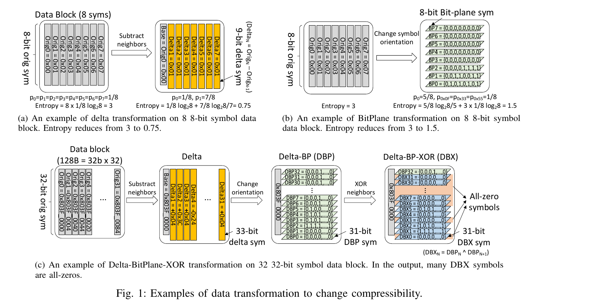
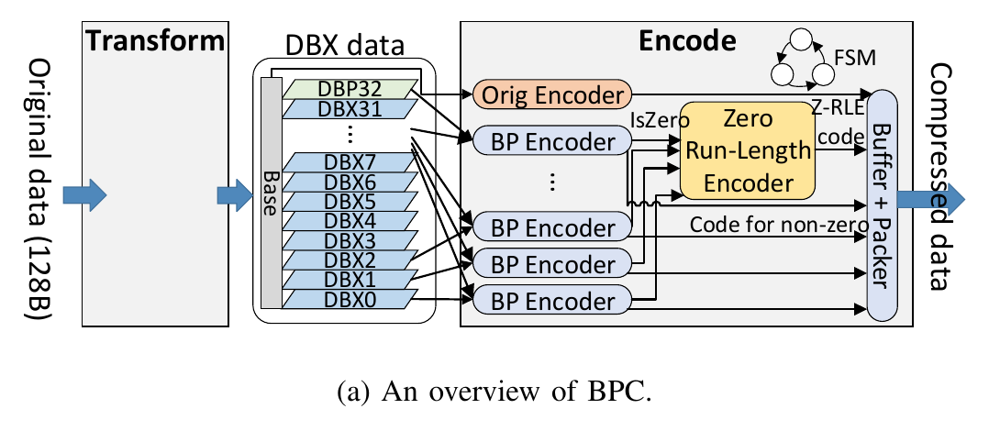

# BPC notes: DBX transform (Fig. 1) and encoder overview (Fig. 3a)

Source: Kim et al., *Bit-Plane Compression*, ISCA 2016, `papers/isca2016_bpc.pdf`, page 5, Fig. 1.



BPC works in two stages:

1. **Transform** the block with Delta-BitPlane-XOR (DBX), shown in the figure above.
2. **Encode** the DBX symbols with run-length encoding (RLE) for runs of all-zero symbols and frequent-pattern compression (FPC) for the rest. The encoder layout is covered further down, under Fig. 3a.

DBX is three steps applied one after another.

## (a) Delta: subtract neighbours

- Read the block as a sequence of words `Orig0 … OrigN-1`.
- `Base = Orig0` and is passed through unchanged.
- `Delta_i = Orig_i − Orig_{i-1}` for `i ≥ 1`.
- Each delta is **one bit wider** than an input word, to hold the borrow bit: 8-bit symbols give 9-bit deltas, and 32-bit words give 33-bit deltas.
- In the example, 0..7 gives deltas of all `0x01`, and entropy drops from 3 bits to 0.75 bits.

## (b) BitPlane: change symbol orientation

- Transpose the block: output symbol `BP_k` holds bit `k` from every input symbol.
- `n` symbols of `w` bits become `w` symbols of `n` bits.
- In the 8×8-bit example, `BP0 = {0,1,0,1,0,1,0,1}` is bit 0 of Orig0..Orig7, and the high planes come out all zero.

## (c) Delta → BitPlane → XOR (the full DBX)

For a 128 B block of 32 × 32-bit words:

| Step | Output |
|---|---|
| Delta | `Base` (32 bit) + 31 deltas × 33 bit |
| Delta-BP (DBP) | `Base` + 33 bit-planes `DBP0..DBP32`, each 31 bit (one bit per delta) |
| Delta-BP-XOR (DBX) | `Base` + `DBP32` + `DBX0..DBX31`, where **`DBX_N = DBP_N ^ DBP_{N+1}`** |

- The top plane `DBP32` holds the sign bits of the deltas and has no plane above it to XOR with, so it is kept as is. The paper calls it the "base bit-plane".
- Why the XOR helps: a small positive delta has its upper bits all 0, and a small negative delta has its upper bits all 1. Either way, neighbouring high planes are equal, so their XOR is **all zeros**. That is what makes RLE effective.
- In the figure, `Base = 0x803F_0000`, and deltas such as `+0x04`, `+0x3C` and `−0x24` leave most of `DBX3..DBX31` all-zero.
- The transform is lossless. To invert it: start from `DBP32`, recover each lower plane with `DBP_N = DBX_N ^ DBP_{N+1}`, transpose back to the deltas, then take a prefix sum from `Base`.

## Our case: 64 B lines (Compresso)

The paper uses 128 B GPU blocks. Compresso uses 64 B CPU cache lines ("decreasing the compression granularity from 128 bytes to 64 bytes", MICRO'18 §1). The paper **does not state the word size** it uses for the 64 B line. Its hardware model does, though: it allows "2 cycles to process **17 bit-planes**" (§6). 17 planes means 17-bit deltas, which means **16-bit words**, so 32 × 16 bit per line.

| | Paper (128 B) | Compresso (64 B, `word_bits=16`) | Alt. (64 B, `word_bits=32`) |
|---|---|---|---|
| words | 32 × 32 bit | 32 × 16 bit | 16 × 32 bit |
| deltas | 31 × 33 bit | 31 × 17 bit | 15 × 33 bit |
| planes | 33 × 31 bit | 17 × 31 bit | 33 × 15 bit |
| DBX symbols | `DBP32` + `DBX0..31` | `DBP16` + `DBX0..15` | `DBP32` + `DBX0..31` |

- With 16-bit words the planes are still 31 bits wide, so the Fig. 3b codes (5-bit positions, 31-bit uncompressed plane) carry over **unchanged**. That supports the 16-bit reading.
- A 16-bit word also matches fp16/bf16 LLM data.
- The word size is a parameter: `BPCConfig.word_bits` (Compresso default 16) and `--word-bits` on the CLI. See **Parameters** below.
- Compresso also runs BPC **with and without** the DBX transform in parallel and keeps the smaller result (§1). That's a separate step from the word size.

## Mapping onto `src/compresso/bpc.py`

Early sketch for `word_bits=32` only. The real stubs in `bpc.py` (`_words`, `_delta`, `_bit_plane`, `_xor`) take a `cfg` and read their sizes from it (`cfg.n_words`, `cfg.delta_bits`, `cfg.plane_bits`) instead of hard-coding them.

```python
WORD_BITS = 32
N_WORDS   = 64 * 8 // WORD_BITS          # 16
DELTA_BITS = WORD_BITS + 1               # 33
MASK33 = (1 << DELTA_BITS) - 1

def _words(line):        # 64 B -> 16 × u32 (little-endian; document it)
    return [int.from_bytes(line[i:i+4], "little") for i in range(0, 64, 4)]

def _deltas(words):      # -> base, 15 deltas as 33-bit two's complement
    return words[0], [(words[i] - words[i-1]) & MASK33 for i in range(1, N_WORDS)]

def _bitplanes(deltas):  # -> DBP[0..32], each an (N_WORDS-1)-bit int
    # bit j of DBP[k] = bit k of deltas[j]  (pick j's bit order and keep it fixed)
    return [sum(((d >> k) & 1) << j for j, d in enumerate(deltas)) for k in range(DELTA_BITS)]

def _dbx(dbp):           # -> DBX[0..31] plus DBP[32] kept unchanged
    return [dbp[k] ^ dbp[k+1] for k in range(DELTA_BITS - 1)], dbp[DELTA_BITS - 1]
```

Test each step by inverting it: `_bitplanes` and its transpose back, `_dbx` and its undo, `_deltas` and its prefix sum. A round-trip test on each step catches off-by-one and bit-order mistakes before the encoder exists.

## BPC overview: Transform → Encode (Fig. 3a)

Source: same paper, page 8, Fig. 3a, plus the text in Section IV-B (pages 7–8).



The pipeline, from left to right:

1. **Transform.** The original block goes through DBX (Fig. 1). The output is `Base`, `DBP32` and `DBX31..DBX0`.
2. **Orig Encoder.** Encodes `Base` (the first original word) on its own, using the shortest code that fits:

   | Base value | Code | Size |
   |---|---|---|
   | 0 | `3'b000` | 3 bit |
   | fits in a signed 4-bit int | `3'b001` + 4 bits | 7 bit |
   | fits in a signed 8-bit int | `3'b010` + 8 bits | 11 bit |
   | fits in a signed 16-bit int | `3'b011` + 16 bits | 19 bit |
   | anything else | `1'b1` + 32 bits | 33 bit |

3. **BP Encoders.** Each bit-plane, `DBP32` and every `DBX_N`, goes through a BP encoder. The encoder does two things:
   - It raises **IsZero** when the plane is all zeros. Zero planes are not coded here; they go to the run-length encoder.
   - For a non-zero plane, it emits a frequent-pattern code. In priority order the patterns are: all 1s; DBX ≠ 0 but DBP = 0; two consecutive 1s; a single 1. If none match, the plane is stored uncompressed behind a 1-bit flag. Fig. 3b gives the exact codes.
   - The "DBX ≠ 0 & DBP = 0" case means the encoder has to see **both** `DBX_N` and `DBP_N` for each plane, not only the DBX value.
4. **Zero Run-Length Encoder (ZBP-RLE).** Takes the IsZero flags and merges consecutive all-zero planes into a single run code, the "Z-RLE code" in the figure. A run of 1 and a run of 2–33 use different codes (Fig. 3b).
5. **Buffer + Packer.** Concatenates the base code, the run codes and the non-zero plane codes into the compressed bitstream. An FSM controls the order.

Hardware detail we can ignore: the paper's pipelined design reuses 9 BP encoders over 4 cycles to cover 33 planes. In software, a loop over the planes does the same job.

### What this means for `bpc.py`

This loop is written out in `_encode_dbx` in `src/compresso/bpc.py`: base first, then planes from the top down, with zero planes collected into runs. You only need to fill in `_encode_base`, `_encode_zero_run` and `_encode_plane`.

- The plane order (sign plane first, `DBP16` for Compresso / `DBP32` in the paper, then the DBX planes down to `DBX0`) follows the figure from top to bottom. The paper doesn't spell out the bitstream order, so this is our choice. The decoder only has to use the same order.
- There are only `cfg.n_planes` planes (17 for Compresso, 33 in the paper), so a zero run is never longer than that. The 2–33 run code covers every case, and each run needs exactly one code.
- The sign plane (`DBP16` / `DBP32`) has no plane above it, so for that plane the "DBX" value and the "DBP" value are the same plane. The "DBX ≠ 0 & DBP = 0" pattern can never fire there.


## Parameters (`BPCConfig` in `bpc.py`)

The defaults are Compresso's (`bpc.COMPRESSO`). `bpc.PAPER_BPC` is the original ISCA'16 setup. Make a variant with `dataclasses.replace(bpc.COMPRESSO, word_bits=32)` and pass it as `cfg=` to `compress_line` / `decompress_line`. A line has to be decompressed with the same config it was compressed with.

| Field | Compresso (default) | BPC paper | What changing it does |
|---|---|---|---|
| `line_bytes` | 64 | 128 | Compression granularity. Bigger blocks compress better but cost latency and move more data per access. |
| `word_bits` | 16 *(inferred from "17 bit-planes")* | 32 | Word size before DBX. Match the data type: 16 for fp16/bf16, 32 for fp32/int32, 64 for doubles. Sets the plane width. |
| `byteorder` | `"little"` | — | How words are read out of the line. x86/ARM dumps are little-endian. |
| `try_no_transform` | `True` | `False` | Also encode without DBX and keep the smaller result. Costs a 1-bit mode flag per line. The paper doesn't define "without the transform". **Our choice:** no Delta and no XOR; bit-plane the raw words (16 planes × 32 bits) and use the same encoder. |
| `run_bits` | 5 *(not stated, kept from the paper)* | 5 | Width of the run-length field. 4 is enough for 17 planes. |
| `base_classes` | (4, 8, 16) | (4, 8, 16) | Size classes for the base word. Classes ≥ `word_bits` are dropped, so 16-bit words give 0/4/8/raw. |
| `bins` | (0, 8, 32, 64) | () | Compressed-line size bins in bytes. 8 bins: 1.82× vs 1.59× ratio, but 17.5% more overflows. |

These are worked out from the fields above, so you don't set them:

| Derived | Compresso | `word_bits=32`, 64 B | BPC paper |
|---|---|---|---|
| `n_words` | 32 | 16 | 32 |
| `n_planes` (= `delta_bits`) | 17 | 33 | 33 |
| `plane_bits` | 31 | 15 | 31 |
| `pos_bits` | 5 | 4 | 5 |

Experiments worth running on the LLM data:
- `word_bits` 16 vs 32. fp16/bf16 tensors should prefer 16, and fp32 activations may prefer 32.
- `try_no_transform` on vs off, to see how much the extra path saves on LLM data.
- 4 vs 8 `bins`, e.g. `(0, 8, 16, 24, 32, 40, 48, 64)`.
- `line_bytes=128`, to compare against the paper's granularity.


Compresso does BPC and compression without BPC, uses the optimal one in parallel

Maybe test more Bs used at some point???

## Implementation status

`src/compresso/bpc.py` is fully implemented and tested in `tests/test_bpc.py` (`make test`):
- **Fig. 1 tests** use the paper's own numbers: the 0..7 example for 1a/1b, and the 128 B `0x803F_0000…` block for 1c, checking every printed delta, DBP and DBX entry.
- **Paper error found:** Fig. 1a says the delta entropy is 0.75, but its own formula `1/8·log2 8 + 7/8·log2(8/7)` comes to **0.544**. Fig. 1b's "1.5" is really 1.549.
- **Fig. 1c filler:** the figure hides Orig5–Orig29 behind "…", so the test fills them with small +4/0 steps, and only the printed entries are checked exactly.
- **Round trips:** random and small-delta lines for 16/32/8/64-bit words, the paper config and big-endian, with every code in Fig. 3b exercised.
- **Sizes** (Compresso config): zero line 8 bits → 0 B bin; ascending words → 8 B bin; random → ~530 bits → stored raw at 64 B.

